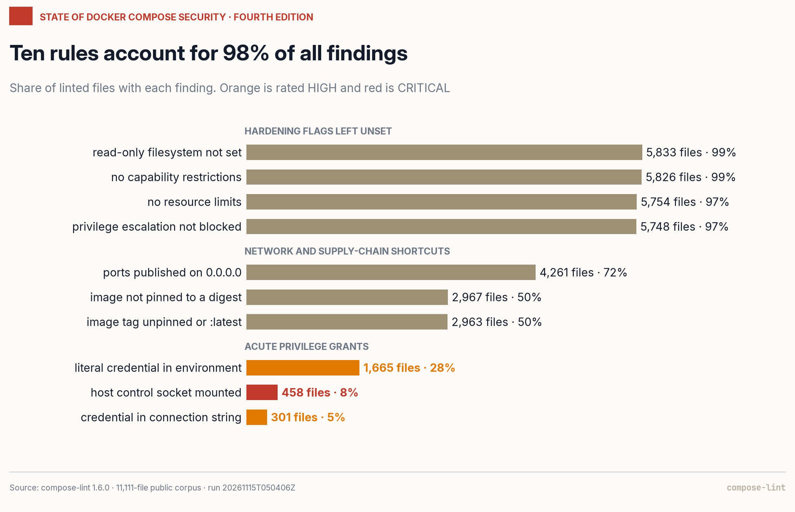
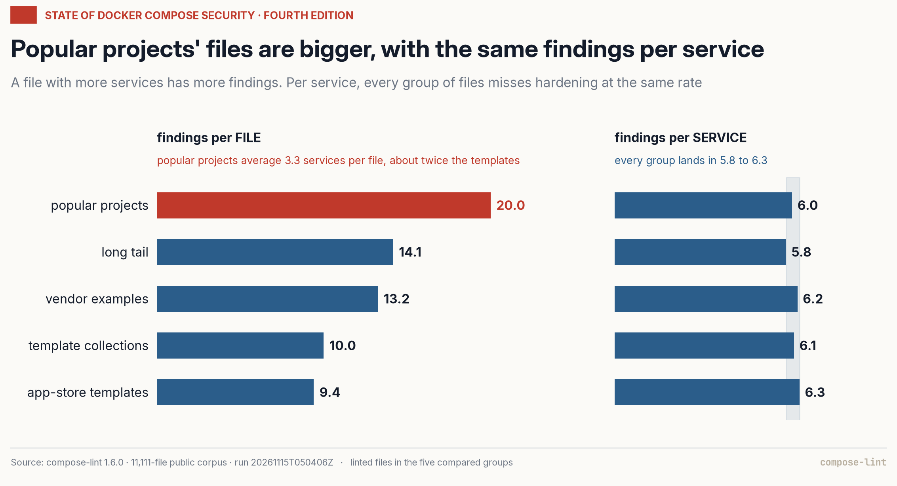
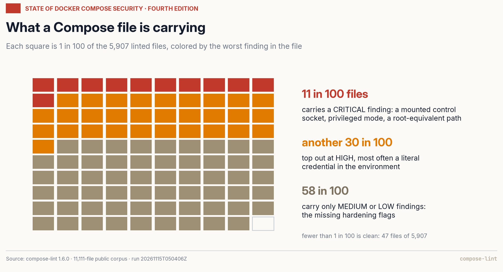
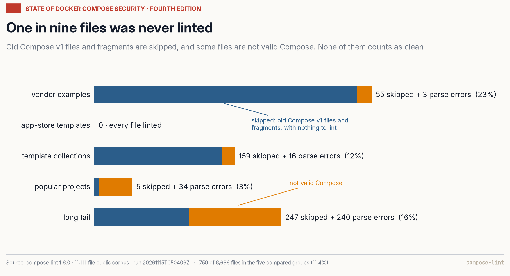

> **Source for the dev.to article.** Derived from the report at
> [docs/state-of-compose.md](../state-of-compose.md). The live article is
> [on dev.to](https://dev.to/tmatens/9-in-10-docker-compose-files-skip-the-basic-security-flags-2dpf).
> Its slug keeps the first edition's title. Everything below this note is the
> article body, starting at "I maintain". See [README.md](README.md) for how
> the article is updated.

I maintain [compose-lint](https://github.com/tmatens/compose-lint), a security linter for Docker Compose files, and I ran it over **11,111 public `docker-compose.yml` and `compose.yaml` files from GitHub**.

6,666 of those are ordinary Compose files. The rest are override files, test fixtures and deliberately vulnerable labs, which the study reports separately and I leave out here. Of the 6,666, compose-lint could lint 5,907. The other 759 use the old Compose v1 layout, are fragments, or aren't valid Compose, which is Finding 3 below. Every percentage below is a share of those 5,907.

Three things stood out:

- **99%** have at least one security finding.
- **96%** set none of the four basic hardening flags.
- The same four findings lead every group of files I looked at, including the official vendor examples people are told to copy.

I don't read this as engineers being careless. Docker Compose leaves the hardening off unless you ask for it, almost nobody asks, and the examples people learn from don't either.

## Why this exists

I run Compose in my home lab. It's quick, there is little ceremony, and it's enough to stand up a stack on a Saturday.

What bugged me was how little security tooling there is for it. Kubernetes and Terraform have plenty of scanners, and Compose is an afterthought in most of them. The Compose tools I found solved other problems. [Hadolint](https://github.com/hadolint/hadolint) lints Dockerfiles. [DCLint](https://github.com/zavoloklom/docker-compose-linter) is mostly about Compose style and structure.

I wanted a linter with no configuration, grounded in OWASP and CIS guidance, that I could drop into CI and run against my own stacks. So I wrote one. Then I got curious whether the things I kept fixing in my own files showed up everywhere else, and they do.

## What I measured

The 6,666 files are sorted by where they came from, because one number for "all Compose files" would average a vendor's polished example with someone's first attempt:

- **Vendor examples** (249 files): awesome-compose, Bitnami, Grafana, Vaultwarden and others. This is what a README tells you to copy.
- **App-store templates** (596): CasaOS, runtipi, Dockge. They are written for a home LAN.
- **Template collections** (1,485): large repos of ready-made stacks.
- **Popular projects** (1,231): the Compose files that projects with 50 or more stars use themselves.
- **Long tail** (3,105): a sweep of GitHub code search. These are ordinary repos that few people look at.

Each of compose-lint's 28 rules cites the [OWASP Docker Security Cheat Sheet](https://cheatsheetseries.owasp.org/cheatsheets/Docker_Security_Cheat_Sheet.html), the CIS Docker Benchmark or Docker's own documentation. The full method is in the [report](https://tmatens.github.io/compose-lint/state-of-compose/).

## Finding 1: the hardening flags are almost never set

Four findings each show up in 97 to 99% of files:



- **Filesystem not read-only** (`read_only: true` missing): 98.7%
- **No capability restrictions** (`cap_drop: [ALL]` missing): 98.6%
- **No resource limits** (no memory or CPU limit): 97.4%
- **Privilege escalation not blocked** (`no-new-privileges` missing): 97.3%

96.2% of files have all four findings, so they set none of the flags.

None of these is rated HIGH. Each one is a control that was left off, which is different from something being actively misused. Setting them looks like this:

```yaml
services:
  app:
    image: nginx:1.30-alpine@sha256:...   # pin a digest along with the tag
    read_only: true                       # CL-0007
    cap_drop: [ALL]                       # CL-0006
    security_opt:
      - no-new-privileges:true            # CL-0003
    deploy:
      resources:
        limits:                           # CL-0026
          memory: 512M
          cpus: '0.50'
```

It is rarely that simple in practice. A read-only filesystem needs a `tmpfs:` for the paths the app writes to, and some images need one or two capabilities added back. The [hardening guide](https://tmatens.github.io/compose-lint/hardening/) walks one file from twelve findings to none and shows what breaks at each step.

**"Aren't these optional settings and not vulnerabilities?"** Mostly, yes. A finding here means the file leaves a recommended control unset. It does not mean anything was exploited.

Whether that matters depends on what the service does and where it runs, and that call belongs to whoever runs it. These four are named controls in the [CIS Docker Benchmark](https://www.cisecurity.org/benchmark/docker) and the OWASP cheat sheet, so the linter is reporting a difference from a published baseline. What it saves you is having to know that each control exists.

## Finding 2: the examples people copy are no better

I expected the vendor examples to be the hardened ones. Every vendor example that lints has at least one finding, 191 of 191. So does every app-store template and every popular project's file. The only clean files in the study are 46 in the long tail and 1 in a template collection.

Popular projects' files have the most findings, about 20 per file against 9 to 14 elsewhere. That looked like a worse result until I counted services:



Per service, every group has about six findings. Popular projects write 3.3 services per file and templates write 1.5 to 2.1, so the popular files are bigger and the rate is the same. A popular project's services are no more hardened than anyone else's, and a vendor's aren't either.

## How serious the findings are

Most findings are the four flags above. The serious ones are less common. This is the worst finding in each file:



Two of those are worth naming. 7.8% of files mount the Docker socket into a container, which hands that container control of the host. In popular projects it is 16.1%. And 28.4% of files have a literal credential in them, more than one in four.

If you run a homelab, your threat model matters here. A box behind a firewall with one user is a different risk from something exposed to the internet, and most findings are something to decide about. I'd start with the CRITICAL and HIGH ones, which is why the CI gate fails on those by default, and work through the four flags after that.

## Finding 3: one in nine files never gets linted

This is the one I didn't expect. 759 of the 6,666 files produced no lint result at all, which is why the percentages above are out of 5,907:



There are two reasons. 466 files use the old Compose v1 layout or are fragments with no services, so there is nothing in them to lint. And 293 are not valid Compose. In the long tail, 7.7% of files fail to parse, and four out of five of those are a shape error like this one:

```yaml
# What a lot of people write (does not parse):
services:
  nginx: nginx:1.27

# What Compose wants:
services:
  nginx:
    image: nginx:1.27
```

A file that doesn't parse was never deployed by a real engine, so these are documentation snippets, tutorial follow-alongs and first drafts.

The first version of this article got this wrong. The linter exits cleanly on a v1 file because it finds nothing to check, and the early editions of the study counted those files as clean. Most of the gap between the 91% I reported then and the 99% here comes from that.

## Why the flags are off

Docker's defaults are chosen so a container runs the first time: a writable filesystem, the default capability set, no limits. Hardening is something you opt into, and that means knowing the control exists, checking that your app still works with it, and adding a few lines per service.

Knowing it exists is the hard part. The controls are spread across the Compose spec, the Docker run reference, the OWASP cheat sheet and the CIS benchmark. Most people writing a Compose file want their stack up, and I don't think it's reasonable to expect them to carry all of that in their head.

It also doesn't get better with time. Files written in the last year have 5.99 findings per service, and files three or more years old have 5.82. The examples never opt in, the next person copies them, and their file becomes someone else's example.

## What this doesn't show

- It counts misconfigurations. It does not show that anything was exploited.
- It describes this sample. There are no significance tests and no estimates for all Compose files.
- It covers public GitHub only. Private and company Compose files may look different.
- It only counts what compose-lint has a rule for. Some hardening, such as a non-root user, a process limit or network segmentation, was left out of the linter on purpose, and the [hardening guide](https://tmatens.github.io/compose-lint/hardening/#hardening-compose-lint-does-not-grade) covers it.

The report has the full list under [what this study does not claim](https://tmatens.github.io/compose-lint/state-of-compose/#what-this-study-does-not-claim).

## Try it on your own files

compose-lint is MIT licensed, needs no configuration, and its only dependency is PyYAML.

```bash
# one-off, without installing anything
uvx compose-lint docker-compose.yml

# or the published image
docker run --rm -v "$(pwd):/src" composelint/compose-lint:1.6.0
```

In CI there is a GitHub Action:

```yaml
# .github/workflows/compose-lint.yml
name: compose-lint
on: [pull_request]
permissions:
  contents: read
jobs:
  lint:
    runs-on: ubuntu-latest
    steps:
      - uses: actions/checkout@v6
      - uses: tmatens/compose-lint@v1
        with:
          pattern: "**/*compose*.y*ml"
          fail-on: high
```

`fail-on: high` is the default. It fails the job only on HIGH and CRITICAL findings, so you can adopt it without fixing every MEDIUM on day one. There is also a pre-commit hook, JSON and SARIF output, and `compose-lint --explain CL-0007` prints any rule's reasoning and fix. Releases are signed and ship with build provenance, and the [repo](https://github.com/tmatens/compose-lint) explains how to verify one.

The tables, the method and the steps to reproduce every number are in the report: **[State of Docker Compose Security](https://tmatens.github.io/compose-lint/state-of-compose/)**. If you maintain a Compose example that other people copy, I'd welcome an issue or a pull request.

**Updated November 2026.** This article was first published in May 2026 with numbers from compose-lint 0.7.0 and 6,444 files. It now uses the fourth edition of the study: compose-lint 1.6.0, 11,111 files, run on November 15, 2026. The [first edition](https://github.com/tmatens/compose-lint/blob/082db9f5c63c5a5637f2e9e2b29d00e345023b00/docs/state-of-compose.md) is still available.

compose-lint is a personal project and is not affiliated with my employer. The views here are my own.
